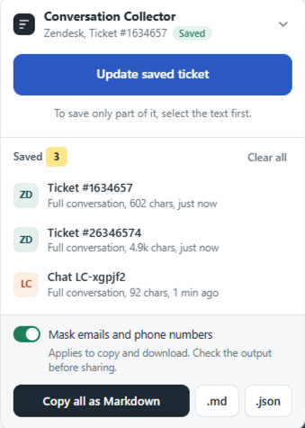

# Zendesk & LiveChat Collector

Often, I need to copy content from several tickets or chats. Copying and pasting everything one by one is tiring, so I made **Zendesk & LiveChat Collector**.

It lets me save a whole ticket or chat in one click, or just the text I select. I can keep collecting while I move between conversations, then copy everything together as clean Markdown when I'm ready for analysis.

It can also mask emails and phone numbers in the exported content.



---

## What's New

### v2.2.3
- **Text.com interface support**: Full support for LiveChat's new **Text.com** platform (`app.text.com`), including updated chat feed DOM structure, bubble group parsing, and speaker detection.
- **Accurate Chat ID & customer title detection**: Automatically extracts IDs from Text.com paths (`/chats/...`, `/archives/...`) and captures customer names in export titles.
- **Backward compatibility**: Continues to support classic LiveChat and Zendesk layouts without disruption.

### v2.2.2
- **Redesigned 3-segment quick launcher**:
  - **Left**: One-click save, or quick copy all Markdown if the current conversation is already collected.
  - **Middle**: Counter badge with a safe two-step click-to-clear confirmation.
  - **Right**: Expand arrow to open the full drawer and export panel.
- **Daily auto-cleanup**: Automatically resets expired items from previous days when you start fresh, even if the browser tab stays open overnight.
- **Draggable & position memory**: Drag the launcher anywhere on your screen and remember its position across page navigations.

---

## How to Use It

This is a Tampermonkey userscript.

**1.** Go to the [Tampermonkey Chrome Web Store page](https://chromewebstore.google.com/detail/tampermonkey/dhdgffkkebhmkfjojejmpbldmpobfkfo) and install the extension.

**2.** Click the Tampermonkey icon in your browser and select **Create a new script**.

Then open [`conversation-collector.user.js`](./conversation-collector.user.js) from this repo. Copy the full script into the Tampermonkey editor and save it.

**3.** Open Zendesk, LiveChat, or Text.com (`app.text.com`), or refresh the page if it is already open. The **Conversation Collector** launcher will appear on the page.

**4.** Click **Save this ticket** in Zendesk or **Save this chat** in LiveChat / Text.com.

If you only need part of the conversation, select the text first and save the selected text instead.

You can keep moving between tickets and chats and add more items to the same saved list.

**5.** When you're ready, click:

- **Copy all as Markdown**
- **.md** to download a Markdown file
- **.json** to download a JSON file

## Privacy

The script runs in your browser. It does not send your tickets, chats, or saved content to me or anyone else.

Your collected content is stored through Tampermonkey in your browser and is only exported when you choose to copy or download it.

The optional masking feature can hide likely email addresses and phone numbers before export, but you should still review the content before sharing it.

## Keyboard Shortcuts

You can also use:

- **Alt + Shift + C** — save the current ticket or chat
- **Alt + Shift + S** — save selected text

On Mac, the interface shows the equivalent Option + Shift shortcuts.

## What It Works With

The script currently works with:

- Zendesk Agent ticket pages
- Text.com (`app.text.com`)
- LiveChat (`my.livechatinc.com`, `*.livechat.com`)

It reads the conversation already visible on the page and keeps the items you collect through Tampermonkey while you move between supported pages.

Because Zendesk and LiveChat / Text.com can change their page structure, the script may need to be updated if either interface changes.

## What's in This Repo

```text
support-ticket-chat-collector/
├── conversation-collector.user.js
├── images/
│   └── collector-panel.png
└── README.md
```

`conversation-collector.user.js` is the complete userscript.

`images/collector-panel.png` is the interface screenshot used in this README.
